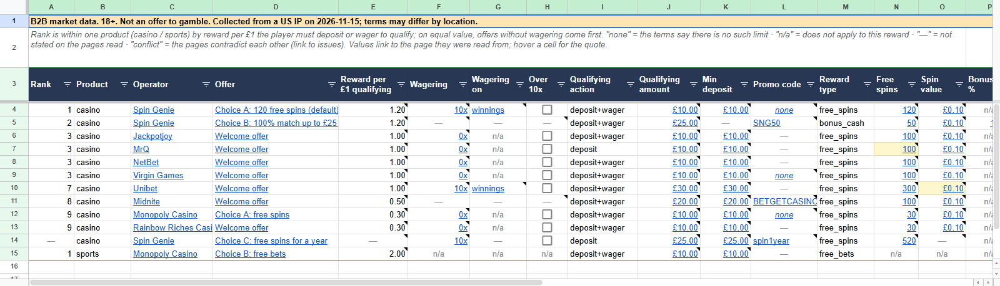
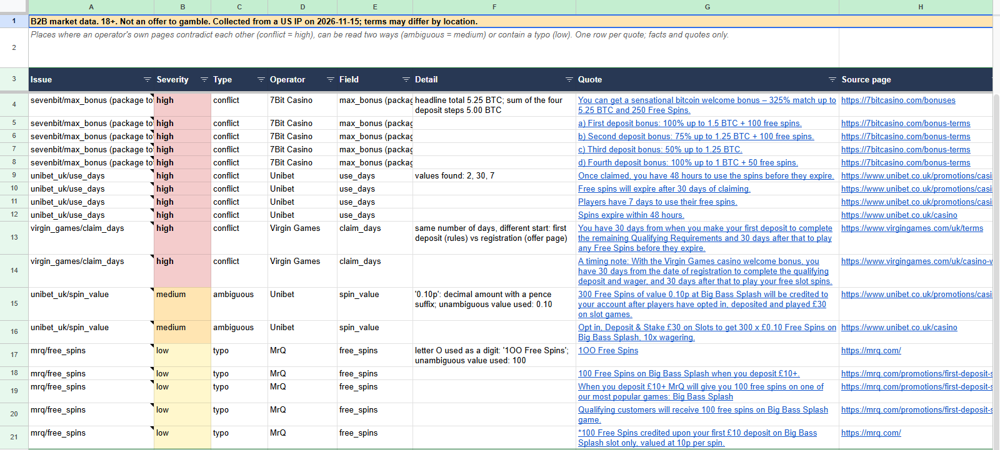
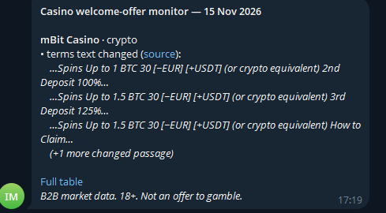

# iGaming Bonus Monitor

**A daily monitor of online-casino welcome-offer terms.** Every day it reads the public offer and
terms pages of licensed casinos, turns each welcome offer into comparable fields (what the player
has to do, what they get, wagering, limits, deadlines), keeps the full terms text, and reports what
changed.

**Who it is for:** affiliates comparing offers, operator marketing teams watching competitors, and
compliance teams checking that offer pages say the same thing everywhere.

**Live sheet (view only):**
[Google Sheets](https://docs.google.com/spreadsheets/d/13MRRAc34eYb6_PAdNCtdZzql4zBKXxglZ6gmqX6Yjbk) —
monitoring has been running since 15 Nov 2026, so the `changes` log has only just started to fill.

**An example of what it finds:** on 15 Nov 2026 one offer page listed three different expiry
periods for the same free spins. Operator names and the verbatim quotes are on the `issues` sheet.

> B2B market data. 18+. Not an offer to gamble. No affiliate links. Not affiliated with any
> operator; brand names are used only to identify the source.

---

## What is tracked

| Market | Licence check | Operators |
|---|---|---|
| **UK** | UK Gambling Commission public register | Unibet, Virgin Games, Jackpotjoy, Monopoly Casino, Rainbow Riches Casino, MrQ, NetBet, Spin Genie, Midnite |
| **Crypto** | Curaçao Gaming Authority (CGA) register — licence holder and number must match | BitStarz, 7Bit Casino, mBit Casino, KatsuBet |

For every welcome offer, one row per reward. When the player chooses between rewards (for example
free spins *or* free bets), each choice is its own row; a crypto welcome package has one row per
deposit step. Fields:

- **Qualifying:** action (deposit / wager / both), amount, minimum deposit, promo code.
- **Reward:** type, bonus %, maximum bonus, free spins and their value, total reward value,
  eligible games, product (casino / sports).
- **Restrictions:** wagering multiplier and what it applies to (bonus / winnings / deposit +
  bonus), maximum bet, maximum win, days to claim, days to use, days to finish wagering, offer end
  date.
- **Source:** the full terms text, its hash, and for every field the page and the verbatim
  sentence it was read from.

## How to read the sheet

| Tab | What it shows |
|---|---|
| `offers_uk` | UK offers, ranked within each product by reward per £1 qualifying; wagering and its base right next to the metric; "Over 10x" checkbox |
| `offers_crypto` | Crypto package steps, sorted by turnover × deposit; days to wager and max bet next to it |
| `issues` | Places where an operator's own pages contradict each other, can be read two ways, or contain a typo — with quotes and links, sorted by severity |
| `changes` | Change log: field was → now, terms text changed, offer appeared / no longer listed |
| `terms` | Full terms text per offer, its hash, the date it last changed |
| `status` | Run health per operator (OK / STALE / DISABLED, noisy terms sources) |
| `history` | One snapshot of every offer per day |

**Metrics**

- **Reward per £1 qualifying** (UK) = total reward value ÷ the amount the player must deposit or
  wager to qualify. 100 free spins at £0.10 for a £10 deposit = 1.00.
- **Turnover × deposit** (crypto) = bonus % ÷ 100 × wagering multiplier: how many times each unit
  deposited has to be wagered to release the bonus. 50% bonus at 35x = 17.5. It does not depend on
  the deposit size. **Required turnover at the maximum bonus** is shown for reference.
- **Over 10x** (UK): wagering above 10 times.

**Every value read from the terms links to the page it was read from; hover a cell to see the quote.** Empty cells
are never guessed. They have distinct states:

| Cell | Meaning |
|---|---|
| `none` | the terms explicitly say there is no such limit or code ("no cap on winnings", "no code needed") |
| `n/a` | the field does not apply to this reward (e.g. wagering on free bets) |
| `—` | not stated on the pages read |
| `conflict` | the pages contradict each other; the cell links to the row on `issues` |

A value that is filled but has an issue raised against it (for example a typo next to a clear
figure) is highlighted.

## Alerts

A Telegram message is sent **only when something changed**: never on the first run (it records the
baseline), never for an operator that could not be read that day, never when nothing changed.

- **One block per operator:** changed fields (was → now, with a source link), flags (wagering went
  above 10x, the offer ends within 7 days, a new issue in the terms, an issue resolved), and the
  passages of the terms text that changed.
- Terms-text passages that a changed field already explains are not repeated: if wagering went
  from 10x to 20x and the text changed only from "x10" to "x20", the block says "terms text updated
  accordingly".
- Offers that appeared or are no longer listed come in one block at the end.
- **Noisy sources:** if an operator's terms text changes on 3 consecutive days beyond what changed
  fields explain, it is marked noisy on `status`, text alerts for it stop (with one notice), and
  field alerts continue.
- Before hashing, the terms text is normalised: case, whitespace, "last updated" stamps, copyright
  years, exchange-rate equivalent lists, invisible characters and typographic quotes. Each rule
  was found on a monitored page. Dates, times and amounts inside the rules are never cut.
- Groups, thresholds and limits (5 lines per block, then "…and N more") are in
  `config/alerts.yaml`. Every message ends with "B2B market data. 18+. Not an offer to gamble."

## Running on GitHub Actions

`.github/workflows/daily.yml` runs the tests, then the monitor, then commits the state the next run
compares against (`data/`) as `github-actions[bot]`. A failed run sends a short notice to Telegram
and writes no data.

**Schedule:** 07:17 UTC (GitHub cron uses UTC; the job avoids `:00`, where scheduled runs queue
longest). **In practice GitHub starts scheduled jobs on this account 7–9 hours late**, so a day's
data usually lands in the afternoon (UTC). For a fixed time, trigger the workflow's
`workflow_dispatch` event from an external scheduler. It can also be started by hand from the
Actions tab.

Repository secrets: `GOOGLE_CREDS` (service-account JSON), `SHEET_ID`, `TELEGRAM_BOT_TOKEN`,
`TELEGRAM_CHAT_ID`.

## Running locally

```bash
uv venv --python 3.11 && uv pip install -r requirements.txt   # or: python -m venv .venv && pip install -r requirements.txt
cp .env.example .env        # GOOGLE_CREDS_PATH, SHEET_ID, TELEGRAM_BOT_TOKEN, TELEGRAM_CHAT_ID
python -m pytest -q

# parse pages saved by a GitHub runner (no network) — the way the tests and the first fill work
python -m src.main --pages-dir tests/fixtures --date 2026-11-15 --no-telegram

# alert test on an artificial "yesterday" (throw-away state; add --send to post it)
python -m tools.alert_demo /tmp/alert-demo
```

`python -m src.main` without `--pages-dir` fetches the pages live. Run it from GitHub Actions
rather than from your own machine: operators show different pages in different countries, and
the monitor is built on what a GitHub runner receives. To save pages as a runner sees them, use the
manual `fetch-pages` workflow (`tools/fetch_pages.py`).

## Project structure

```
config/operators.yaml   operators, licences, pages read; disabled entries keep their reason
config/alerts.yaml      alert groups, thresholds, limits, caption
src/http_client.py      polite client: robots.txt, 2–5 s delays, honest User-Agent; blocks and
                        geo-blocks are detected and never worked around
src/operators/          one parser per operator or shared site template
src/parse_common.py     shared reading of amounts, days, wagering; candidate values with quotes
src/models.py           Offer / Issue records and the metrics
src/terms_text.py       terms normalisation, volatile-part rules, readable diff
src/state.py            state between runs: last offers, issues, terms, changes, noisy sources
src/tables.py           what each sheet shows (testable without Google)
src/sheets.py           Google Sheets writer
src/alerts.py           Telegram message
src/main.py             the daily run
tools/                  page fetcher, fixture shrinker, review and alert-demo scripts
tests/                  110 tests on pages fetched by a GitHub runner (tests/fixtures)
data/                   state committed by the daily run
```

## Screenshots

**`offers_uk`** — ranked within each product; every figure links to its source page, empty cells
say why they are empty.



**`issues`** — contradictions, two-way wording and typos on the operators' own pages, with quotes.



**Telegram alert** — from the first live run: one operator changed the currency of its minimum
deposit on the offer page.




## Limitations

- **The data is what the sites serve to GitHub's US addresses.** Runners egress from the US;
  operators can show other terms, currencies or no offer at all elsewhere. Every sheet says when and
  from where the data was collected.
- **13 of 76 sites checked are monitored.** The largest brands are closed to automated readers
  (403 / Cloudflare challenge), geo-block US addresses, disallow it in robots.txt, render their
  terms only with JavaScript, or show a non-UK version to a US address. None of this is worked
  around: no proxies, no VPN, no headless browser, no captcha solving.
- **Crypto casinos only with a licence confirmed in the CGA register** (holder and licence number).
  Brands with an expired licence or a licence from another authority are left out.
- **Fields that cannot be read unambiguously stay empty.** Contradictions and two-way wording are
  recorded on `issues` with quotes instead of being resolved by guesswork.
- **Reward per £1 qualifying ignores wagering and game restrictions.** It compares headline value,
  not how attractive an offer is; read it together with the wagering columns.
- **The displayed currency of some crypto operators can depend on where the request comes from.**
  On 15 Nov 2026 the same page showed a minimum deposit in EUR in the morning and in USDT in the
  afternoon.
- GitHub starts scheduled runs late (see Schedule), so "daily" means once per calendar day, not at
  a fixed hour.

## Disclaimer

B2B market data. 18+. Not an offer to gamble. No affiliate links. Not affiliated with any operator;
brand names are used only to identify the source.

## License

MIT — see [LICENSE](LICENSE).
